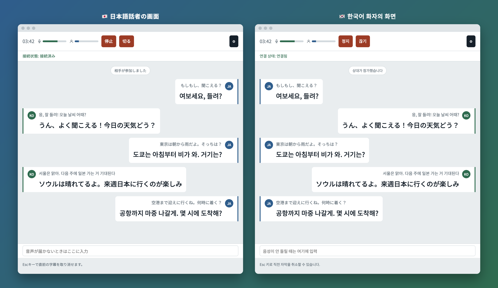
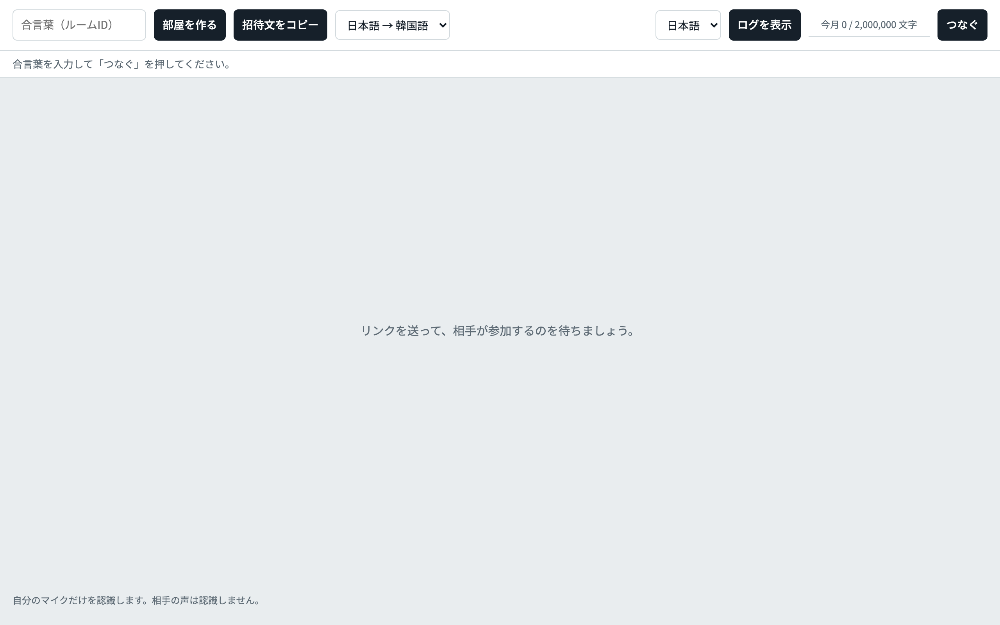
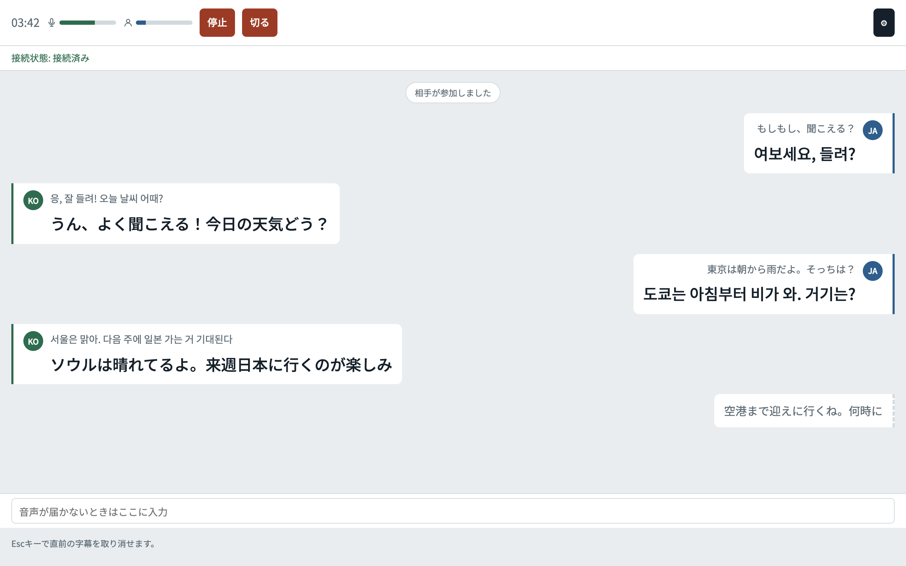
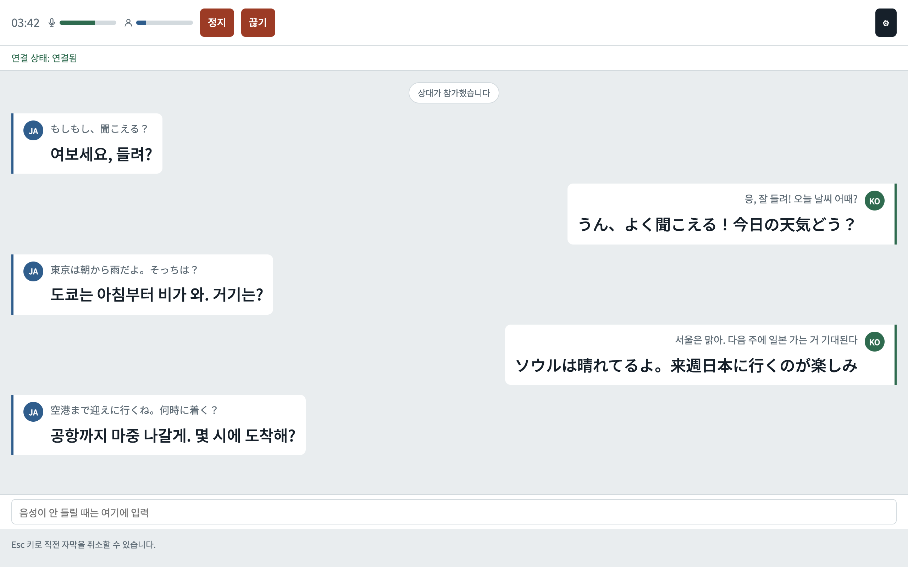
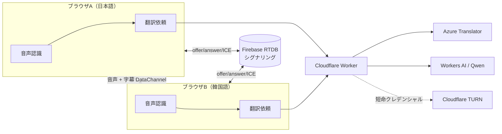

# ライブ翻訳 通話+字幕

2人用のJA↔KO音声通話＋リアルタイム字幕アプリ。`call.html` 単体で動く静的サイトで、
シグナリングにFirebase Realtime Database、音声にWebRTC（P2P）、字幕の翻訳と
TURN中継クレデンシャルの発行にCloudflare Workerを使う。



日本語話者と韓国語話者が、お互いの言葉を話しながら通話できる。話した内容は自分の画面に原文で表示され、
相手の画面には相手の言語に翻訳された字幕が届く。UIも日本語・韓国語を切り替えられる。

> 対応環境: PCのChrome / Edge（音声認識にWeb Speech APIを使うため。スマホでは動作しない）

## スクリーンショット

| 通話前（部屋を作ってリンクを送る） | 通話中（認識途中の発話は点線で先に表示） |
| --- | --- |
|  |  |

| 韓国語UI |
| --- |
|  |

## 主な機能

- **P2P音声通話**: WebRTCで直接つなぎ、NAT越えできないときはCloudflare TURNで中継する
- **リアルタイム字幕**: ブラウザの音声認識（Web Speech API）で自分の声だけを文字にし、翻訳してDataChannelで相手に送る
- **先読み翻訳**: 認識途中の文が1.2秒変化しなければ、確定を待たずに翻訳を始めて字幕の遅延を減らす
- **翻訳エンジンの振り分け**: 短い発話はAzure Translator、長い発話はLLM（Workers AI / Qwen）。失敗したらもう一方へ自動フォールバック
- **会話文脈・固有名詞対応**: 直前のやりとりを文脈としてLLMに渡し、人名などは対応表（`names.json`）で表記を揃える
- **誤認識補正と定型文**: `glossary.md` で音声認識の誤りを直し、`fixed-phrases.md` に一致するあいさつ等は翻訳APIを呼ばずに即答する
- **入力の補助**: 音声が通らないときのテキスト入力、Escキーで直前の字幕を取り消し、自分の発言の削除
- **リンクで招待**: ランダムなroom IDのリンクと、UI言語（日本語/韓国語）に合わせた招待文をワンクリックでコピー
- **通話ログ**: 原文・訳文を日付ごとにブラウザ内に保存し、あとから見返し・コピーできる
- **相手のマイク状態表示**: 自分と相手の音量メーターで「声が届いているか」を確認できる

## 技術スタック

| 役割 | 使用技術 |
| --- | --- |
| フロントエンド | 素のHTML/CSS/JavaScript（ビルド不要の単一ファイル）、GitHub Pagesで配信 |
| 音声通話 | WebRTC（音声トラック + DataChannel） |
| シグナリング | Firebase Realtime Database（セキュリティルールで書き込みを制限） |
| 音声認識 | Web Speech API（Chrome / Edge） |
| 翻訳 | Cloudflare Workers → Azure Translator / Workers AI（Qwen3） |
| NAT越え | Cloudflare Realtime TURN（通話ごとに短命クレデンシャルを発行） |

## 仕組み



翻訳は**送信側**で行い、訳文をDataChannelで相手に送る（受信側で翻訳するより1往復ぶん遅くなるが、
話した本人が訳文を確認でき、取り消し・訂正も送信側で完結する）。APIキーはすべてWorker側のシークレットに置き、
ブラウザには出さない。

## 工夫した点

- **APIキーをクライアントに置かない**: 翻訳APIとTURNのキーはWorkerのシークレットに保持し、許可オリジンとIP単位のレート制限をサーバー側でかける
- **部屋の乗っ取り対策**: room IDは72ビットの乱数。DBルールでoffer/answerを書き込み1回限りにし、通話成立後のSDPすり替えを防ぐ
- **後片付け**: `onDisconnect` でタブを閉じただけでも部屋のデータが消える
- **落ちない設計**: TURN発行に失敗してもSTUNのみで通話を続け、翻訳エンジンが落ちてももう一方に切り替える。音声認識が無音で止まったら自動で再起動する
- **段階的な検証**: 同じPCの2タブ → 同じWi-Fiの2台 → 別ネットワークの順にテストし、コードの不具合とNAT/TURNの問題を切り分けた

---

# セットアップ

## 構成

```
call.html                    アプリ本体（単一HTMLファイル）
index.html                   旧Gemini版プロトタイプの名残。call.htmlへリダイレクトするだけ
firebase-config.js           Firebaseの接続設定（web app config。値は非シークレット、後述）
database.rules.json          Realtime Databaseのセキュリティルール
firebase.json / .firebaserc  Firebase CLIのデプロイ設定
glossary.md                  誤認識補正の辞書（call.htmlがfetchで読み込む）
fixed-phrases.md             定型フレーズの即答表（call.htmlがfetchで読み込む）
worker/
  index.js                   翻訳中継 + TURNクレデンシャル発行のWorker本体
  wrangler.toml               Workerのデプロイ設定（[ai] binding含む）
  names.json                  固有名詞の日本語↔韓国語表記対応表（Workerが直接import）
```

## 前提として必要なもの

- Firebaseアカウント・プロジェクト（Realtime Database）
- Cloudflareアカウント（Workers AI・Realtime TURNを使う）
- Azure Portalの Translator リソース（フォールバック用）
- Node.js（`wrangler`・`firebase-tools`は都度 `npx` で実行する。グローバルインストールは不要）

---

## 1. Firebaseのセットアップ

1. [Firebaseコンソール](https://console.firebase.google.com/)で新規プロジェクトを作成する
2. 「構築」→「Realtime Database」を有効化する（ロケーションは任意）
3. 「プロジェクトの設定」→「全般」→「マイアプリ」でウェブアプリを追加し、表示された設定値を `firebase-config.js` に書く

   ```js
   export const firebaseConfig = {
     apiKey: "...",
     authDomain: "...",
     databaseURL: "...",   // Realtime DatabaseのURL。忘れずに入れる
     projectId: "...",
     storageBucket: "...",
     messagingSenderId: "...",
     appId: "..."
   };
   ```

   このファイルはリポジトリにそのままコミットする。`apiKey` はFirebaseの設計上クライアントに露出する前提の値で、実際の防御は次のセキュリティルール側にある。

4. Firebase CLIにログインし、プロジェクトIDを `.firebaserc` に設定する

   ```bash
   npx firebase-tools login
   ```

   ```json
   // .firebaserc
   {
     "projects": {
       "default": "<あなたのプロジェクトID>"
     }
   }
   ```

5. セキュリティルールをデプロイする（`database.rules.json` が対象。`firebase.json` で指定済み）

   ```bash
   npx firebase-tools deploy --only database
   ```

   現在デプロイされているルールを確認したいときは:

   ```bash
   npx firebase-tools database:get /.settings/rules --project <プロジェクトID> --instance <プロジェクトID>-default-rtdb
   ```

### ルールの内容

`rooms/$roomId` は `$roomId` が12文字以上のときだけ認証なしで読み書きできる。room IDはcall.html側で `crypto.getRandomValues` により72ビットのランダム値として生成しており、この長さ条件を満たす（推測でIDを当てるのは非現実的だが、IDそのものが漏れた場合の防御ではない）。

`offer`/`answer` は一度書き込まれたら別の内容での再書き込みを拒否する（通話成立後に第三者が同じroomへ割り込んでSDPをすり替える攻撃を防ぐ）。ただし部屋ごとの削除（`hangup`/`onDisconnect`）は引き続きできる。`offerCandidates`/`answerCandidates` はこの制限の対象外。

---

## 2. Cloudflare Workerのセットアップ

`call.html` は翻訳とTURNクレデンシャルの発行をどちらも直接呼ばず、`worker/` のCloudflare Workerを経由する。

- 翻訳: 短い発話（`text.length <= 8`）はAzure Translator、それ以外はWorkers AI（Qwen）を主経路にし、失敗時は自動でもう一方にフォールバックする
- TURN: Cloudflare Realtime TURNは固定クレデンシャルを発行できない仕様のため、通話のたびにWorker経由（`GET /api/ice`）で短命クレデンシャル（TTL 1時間）を発行する。キー未設定・API障害・応答の検証失敗のいずれでも、通話は落とさずSTUNのみにフォールバックする

### 事前準備

- `npx wrangler login`
- Azure PortalでTranslatorリソースを作成し、キーとリージョンを控えておく
- CloudflareダッシュボードでRealtime（TURN）のキーを発行し、Key IDとAPI Tokenを控えておく（[Cloudflare Realtime TURNのドキュメント](https://developers.cloudflare.com/realtime/turn/)参照。ダッシュボードの項目名は変わる可能性があるため「TURN」で探すのが確実）

### シークレットの登録

`worker/` ディレクトリで実行する。値はコードに書かず、対話式で入力する。

```bash
cd worker

npx wrangler secret put AZURE_TRANSLATOR_KEY
npx wrangler secret put AZURE_TRANSLATOR_REGION
npx wrangler secret put TURN_KEY_ID
npx wrangler secret put TURN_KEY_API_TOKEN
```

登録済みの一覧は次で確認できる（値そのものは表示されない）。

```bash
npx wrangler secret list
```

### デプロイ

```bash
cd worker
npx wrangler deploy
```

デプロイが終わると `https://live-translate-translator.<あなたのサブドメイン>.workers.dev` のようなURLが表示される。

---

## 3. アプリ側の設定

Workerのデプロイ後、`call.html` 内の以下を書き換える。翻訳（`POST /`）とTURNクレデンシャル発行（`GET /api/ice`）は両方ともこのURLを使うため、書き換えるのはここ1箇所でよい。

```js
const TRANSLATE_WORKER_URL = "https://live-translate-translator.xxxx.workers.dev";
```

Worker側の許可オリジンも、自分のGitHub Pages URLに合わせて書き換える。

```js
// worker/index.js
const ALLOWED_ORIGINS = new Set([
  "https://<あなたのGitHubユーザー名>.github.io",
  "http://localhost:8000"
]);
```

書き換えたら `call.html` はコミットしてGitHub Pagesへpush、`worker/index.js` は `npx wrangler deploy` で反映する。

---

## 4. 制限（Worker側で強制している内容）

- 許可オリジン: `ALLOWED_ORIGINS`（CORSに加え、サーバー側でも拒否）
- レート制限（Worker内メモリでの簡易カウントのため、複数拠点・複数アイソレートをまたぐと厳密ではない。2人だけの私用アプリという前提での簡易対策）
  - 翻訳: 同一IPから1分あたり60回まで（`RATE_LIMIT_MAX`）
  - TURNクレデンシャル発行: 同一IPから1分あたり10回まで（`ICE_RATE_LIMIT_MAX`。通話開始時に1回呼ぶだけなので翻訳より厳しくしている）
- 1リクエストの `text` は1〜2000文字（`MAX_TEXT_LENGTH`）
- 翻訳エンジンの振り分け: `text.length` が8文字以下（`SHORT_TEXT_THRESHOLD`）ならAzure、それ以外はWorkers AIを主経路にする。どちらを使っても失敗時は自動でもう一方にフォールバックする
- Workers AIのモデルは `WORKERS_AI_MODEL` 定数で変更できる（現在は `@cf/qwen/qwen3-30b-a3b-fp8`）
- TURNクレデンシャルのTTLは `TURN_TTL_SECONDS`（現在3600秒＝1時間）。失敗時は `stun:stun.cloudflare.com:3478` のみで応答する

---

## ローカルで動作確認する場合

```bash
cd worker
npx wrangler dev
```

`http://localhost:8000` をOriginとして許可しているので、`call.html` をローカルサーバー（`python3 -m http.server 8000` など）で開いてテストできる。
